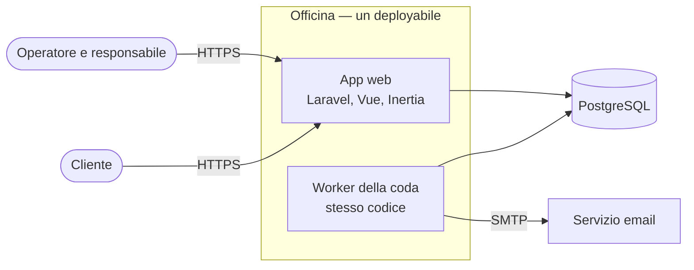
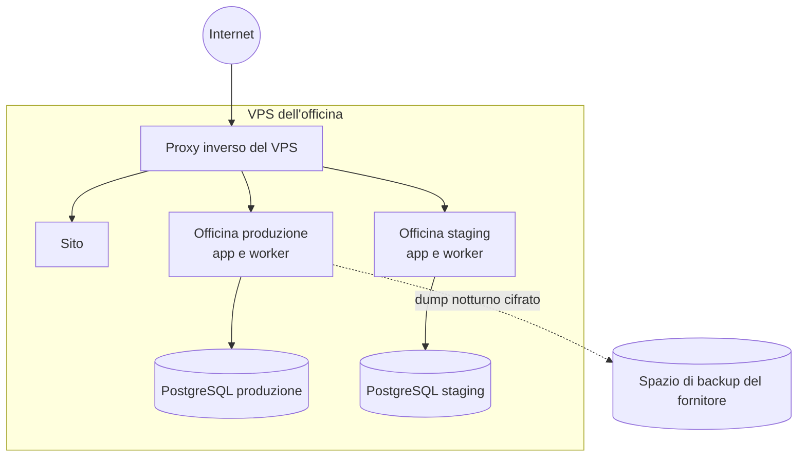

+++
fase = 4
+++
# Architettura di Officina

Il contesto (chi usa il sistema, con quali sistemi esterni dialoga) e il grafo dei moduli sono viste generate: `viste/contesto.md` e `viste/moduli.md`. Qui stanno le viste che nessuna sorgente può generare: container e deployment. Il perché delle scelte è negli ADR.

## Container

Un solo deployabile (ADR-0003): l'app Laravel serve l'API e le pagine Vue con Inertia; un worker dello stesso codice consuma la coda delle email.

## Deployment

Lo stesso VPS del sito (V-1), dietro il proxy inverso che già esiste. Staging è un secondo utente con un secondo database sullo stesso VPS: prova rilascio, ripristino e carico senza costi in più (V-2). L'infrastruttura è descritta come codice da uno script di provisioning versionato nel repo.

Scalabilità: verticale, nel limite di RNF-5; nessuna replica (ST-dati). Rete: solo il proxy esposto; database in ascolto su localhost.
