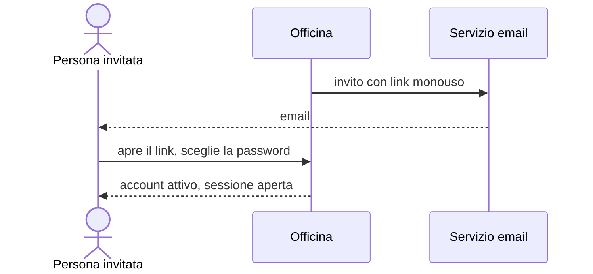

+++
id = "accesso-e-attivazione"
titolo = "Caso d'uso: dall'invito al primo accesso"
tipo = "caso-d-uso"
storie = ["CLI-1", "ACC-2", "ACC-5", "ACC-1", "ACC-4", "ACC-7"]
entita = ["account", "cliente"]
+++
# Dall'invito al primo accesso

**Attore primario**: chi riceve l'invito (cliente o operatore). **Precondizione**: un account invitato, creato dal responsabile (ACC-2) o con la registrazione del cliente (CLI-1).

**Scenario principale**
1. Officina invia l'email d'invito con un link monouso valido 72 ore.
2. La persona apre il link e sceglie una password di almeno 12 caratteri.
3. L'account diventa attivo e la persona entra.
4. Agli accessi successivi inserisce email e password; il responsabile anche il codice del secondo fattore.

**Estensioni**
- 2a. Link già usato o scaduto: link-non-valido, il responsabile può reinviare l'invito.
- 2b. Password troppo corta: password-debole, l'account resta invitato.
- 4a. Quinto tentativo fallito: l'account si blocca finché il responsabile non lo sblocca (R-6, ACC-7).

