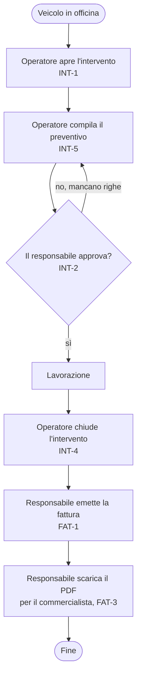

+++
id = "ciclo-intervento"
titolo = "Ciclo di un intervento, dall'accettazione alla fattura"
tipo = "attivita"
storie = ["INT-1", "INT-5", "INT-2", "INT-4", "FAT-1", "FAT-3"]
entita = ["intervento", "preventivo", "riga_preventivo", "fattura"]
+++
# Ciclo di un intervento

Il processo principale dell'officina, con chi fa cosa. Gli stati dell'intervento e del preventivo stanno nelle macchine a stati; qui si vede il passaggio di mano tra operatore e responsabile, che è la ragione di INT-2 e del conflitto CO-1.

Eccezioni lungo il processo: un secondo intervento aperto sullo stesso veicolo è rifiutato (R-4); la chiusura senza preventivo approvato è rifiutata (R-1); una fattura emessa non cambia più (R-3).
