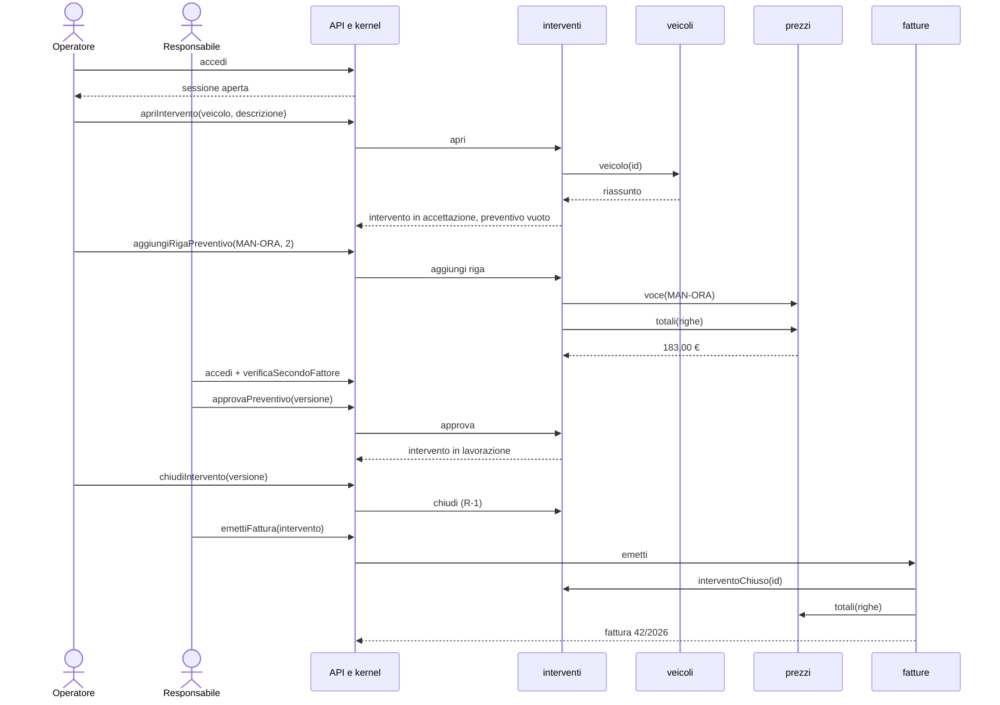

+++
percorso = "PC-1"
operazioni = ["accedi", "verificaSecondoFattore", "apriIntervento", "aggiungiRigaPreventivo", "approvaPreventivo", "chiudiIntervento", "emettiFattura"]
facciate = ["veicoli.veicolo", "prezzi.voce", "prezzi.totali", "interventi.interventoChiuso"]
+++
# PC-1 — intervento completo

Dall'accesso alla fattura, attraverso le facciate. Ogni freccia verso un modulo è una chiamata di facciata; il kernel applica la matrice prima di ogni operazione.

