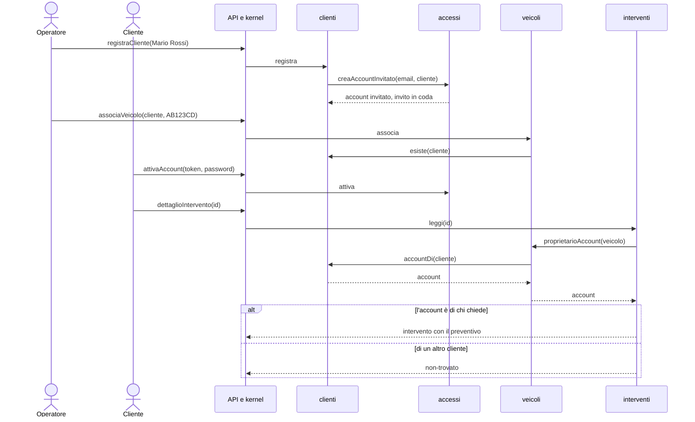

+++
percorso = "PC-2"
operazioni = ["registraCliente", "associaVeicolo", "attivaAccount", "dettaglioIntervento"]
facciate = ["accessi.creaAccountInvitato", "clienti.esiste", "veicoli.proprietarioAccount", "clienti.accountDi"]
+++
# PC-2 — il cliente segue il suo intervento

La condizione di proprietà della matrice è il punto delicato: per leggere un intervento il kernel chiede a interventi, che chiede a veicoli, che chiede a clienti l'account del proprietario. Se non coincide con chi chiede, la risposta è non-trovato, senza indizi che l'intervento esista (MI-1).

