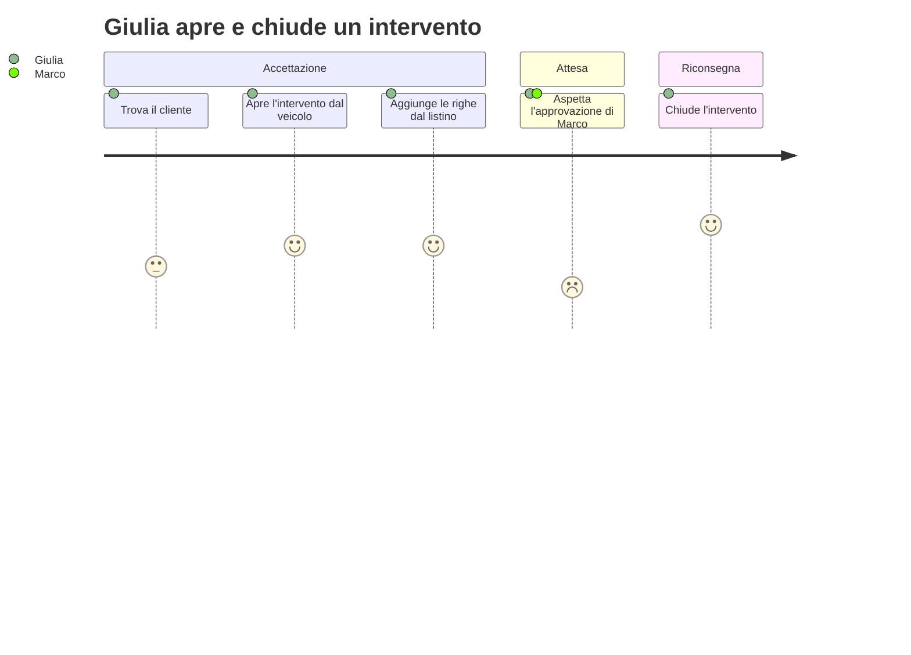
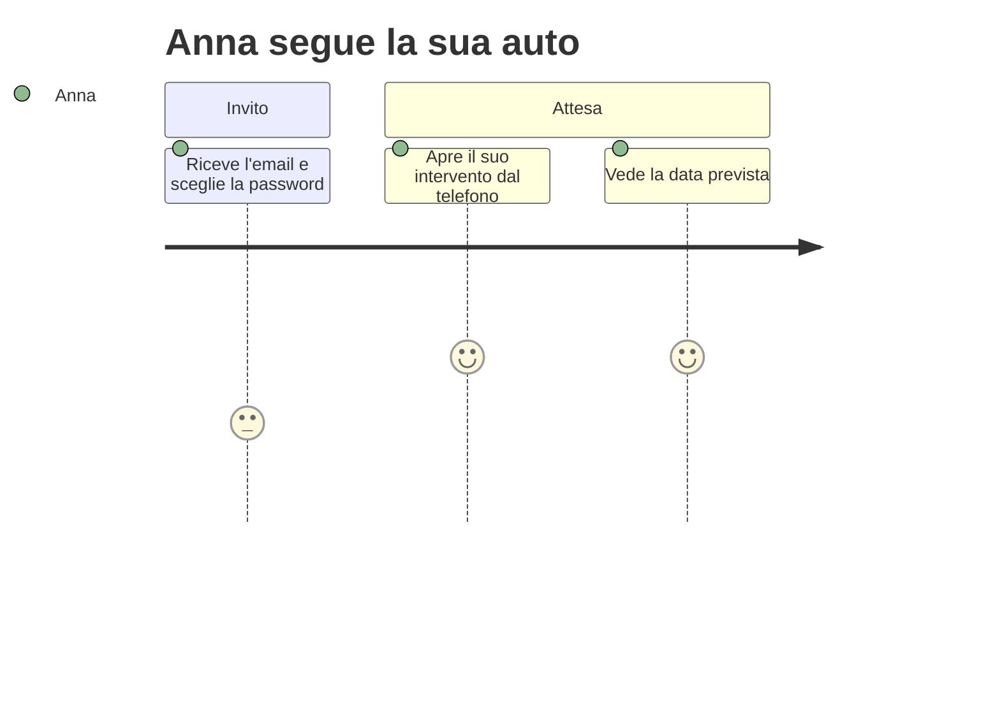

+++
fase = 6
personas = ["giulia", "marco", "anna"]
+++
# Utenti e percorsi

Progetto pubblicabile: la ricerca è stata un'osservazione di mezza giornata al banco dell'officina e due conversazioni con il responsabile, non una campagna di interviste. Il test con utenti reali è rinviato al passaggio al pubblico (voce 6.08, debito di pubblicazione).

## Personas

- **Giulia, operatrice** — al banco con il telefono che squilla, usa il PC dell'officina. Vuole aprire un intervento in meno di un minuto e non riscrivere mai lo stesso dato.
- **Marco, responsabile** — approva tra un lavoro e l'altro, spesso dal telefono. Vuole approvare e fatturare in pochi tocchi, con i totali giusti.
- **Anna, cliente** — apre il link dal telefono. Vuole sapere quando riavrà l'auto senza telefonare.

## Journey di Giulia, PC-1

## Journey di Anna, PC-2

