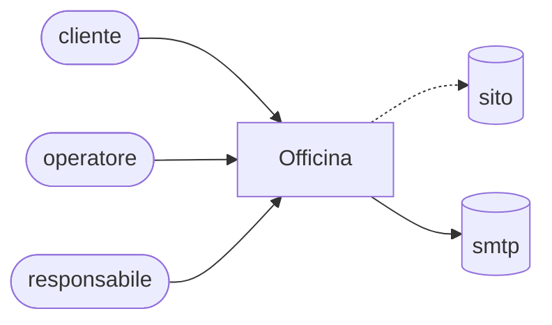

<!-- Generato da app-blueprint (progetto.py viste): non modificare a mano. Le sorgenti sono in docs/progettazione/ e contracts/. -->

# Diagramma di contesto

Generato da prodotto/prodotto.toml: chi usa il sistema e con quali sistemi esterni dialoga.

