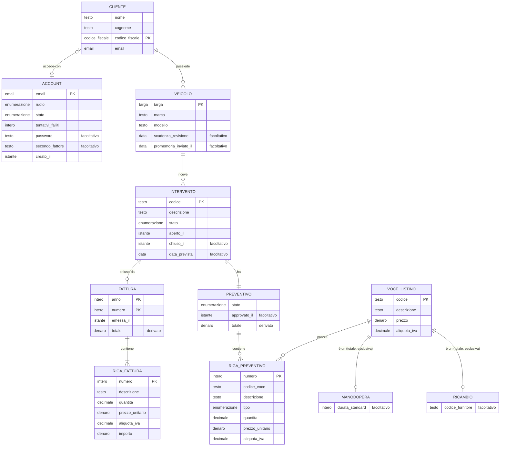

<!-- Generato da app-blueprint (progetto.py viste): non modificare a mano. Le sorgenti sono in docs/progettazione/ e contracts/. -->

# Schema E/R concettuale

Generato da dominio/entita.toml. Notazione a zampa di gallina: il simbolo accanto a un'entità dice quante sue istanze partecipano per ogni istanza dell'altra. Gli identificatori principali sono marcati PK, gli altri UK.

## Proprietari

| entità | modulo | descrizione |
|---|---|---|
| account | accessi | L'accesso di una persona a Officina. |
| cliente | clienti | Chi porta i veicoli in officina e riceve le fatture. |
| fattura | fatture | Documento emesso per un intervento chiuso; immutabile (R-3). |
| intervento | interventi | Il lavoro su un veicolo, dall'accettazione alla chiusura. |
| manodopera | prezzi | Voce di listino prezzata a ore. |
| preventivo | interventi | Le righe di un intervento; uno per intervento. |
| ricambio | prezzi | Voce di listino prezzata a pezzo. |
| riga_fattura | fatture | Copia di una riga del preventivo approvato all'emissione. |
| riga_preventivo | interventi | Una voce del listino nel preventivo, con i valori del momento. |
| veicolo | veicoli | Un mezzo di un cliente. |
| voce_listino | prezzi | Una prestazione o un ricambio con prezzo e aliquota. |
