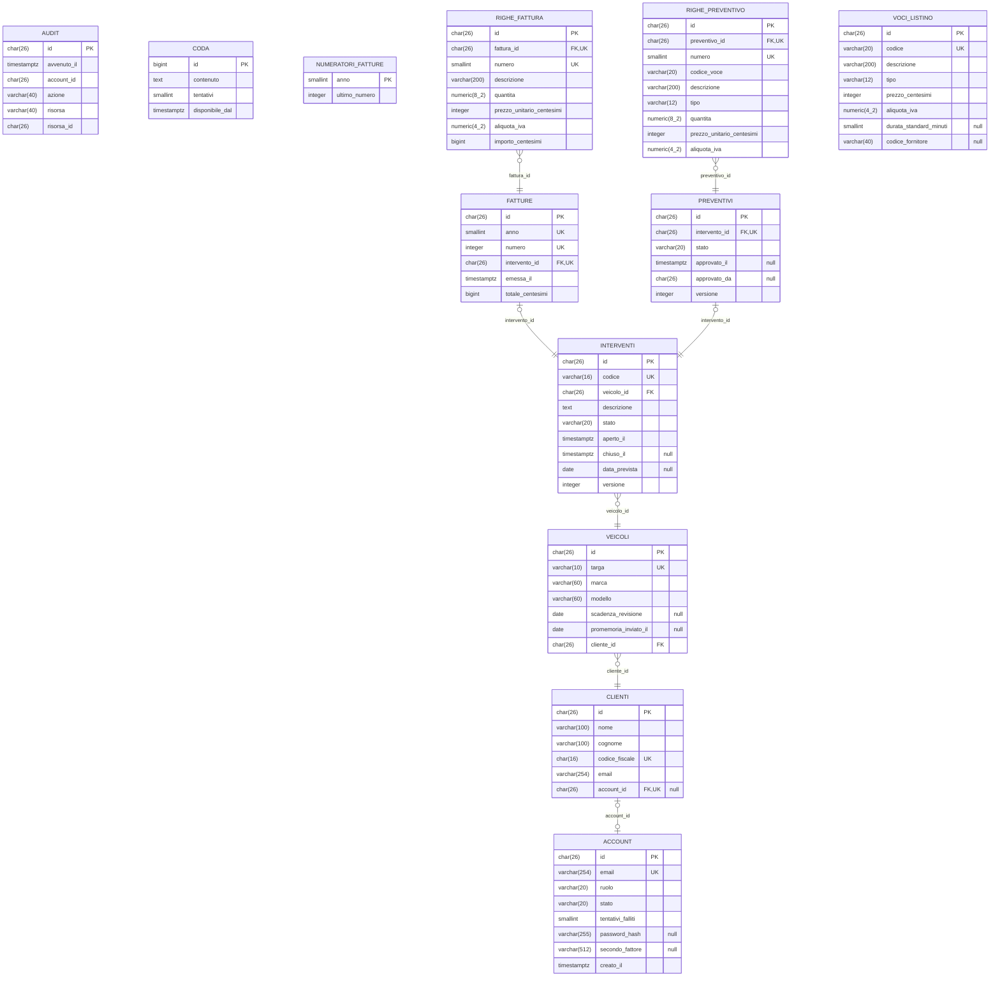

<!-- Generato da app-blueprint (progetto.py viste): non modificare a mano. Le sorgenti sono in docs/progettazione/ e contracts/. -->

# Schema logico

Generato da contracts/schema.toml: tabelle, chiavi e chiavi esterne.

| tabella | modulo | forma normale | traduce |
|---|---|---|---|
| account | accessi | BCNF | entita:account |
| audit |  | BCNF |  |
| clienti | clienti | BCNF | entita:cliente |
| coda |  | BCNF |  |
| fatture | fatture | BCNF | entita:fattura, relazione:intervento-fattura |
| interventi | interventi | BCNF | entita:intervento |
| numeratori_fatture | fatture | BCNF | entita:fattura |
| preventivi | interventi | BCNF | entita:preventivo, relazione:intervento-preventivo |
| righe_fattura | fatture | BCNF | entita:riga_fattura, relazione:fattura-righe |
| righe_preventivo | interventi | BCNF | entita:riga_preventivo, relazione:preventivo-righe |
| veicoli | veicoli | BCNF | entita:veicolo |
| voci_listino | prezzi | BCNF | entita:voce_listino, entita:manodopera, entita:ricambio |
