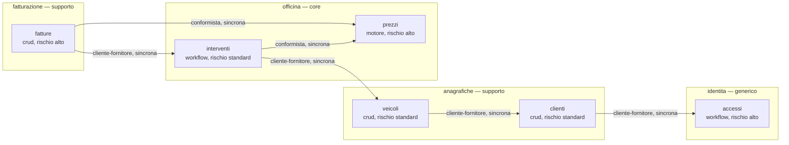

<!-- Generato da app-blueprint (progetto.py viste): non modificare a mano. Le sorgenti sono in docs/progettazione/ e contracts/. -->

# Moduli e context map

Generata da dominio/moduli.toml. Una freccia va dal modulo a valle a quello da cui dipende.

| modulo | responsabilità | entità possedute |
|---|---|---|
| accessi | Ciclo di vita degli account, accesso, secondo fattore, inviti e recupero; nessuna regola di dominio dell'officina. | account |
| clienti | Anagrafica dei clienti e collegamento al loro account. | cliente |
| fatture | Emissione, numerazione e PDF delle fatture. | fattura, riga_fattura |
| interventi | Interventi e preventivi, con le loro macchine a stati. | intervento, preventivo, riga_preventivo |
| prezzi | Listino e motore dei prezzi: l'unico posto dove si calcolano i totali (R-2). | manodopera, ricambio, voce_listino |
| veicoli | Veicoli dei clienti e loro proprietario. | veicolo |
