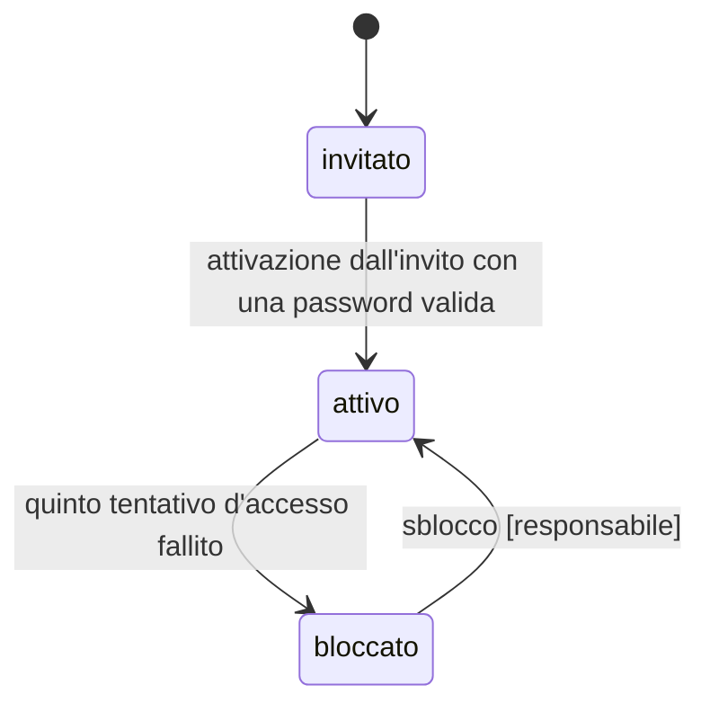
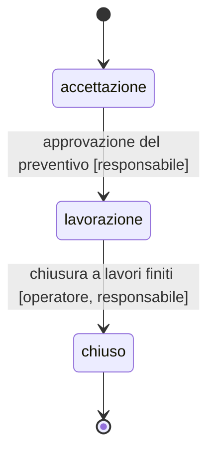
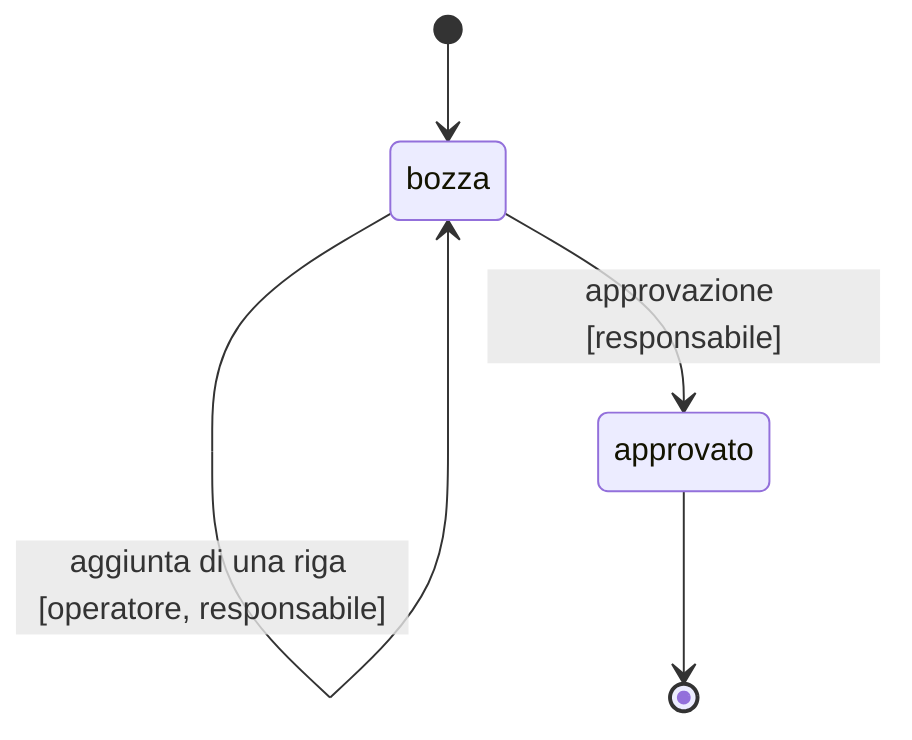

<!-- Generato da app-blueprint (progetto.py viste): non modificare a mano. Le sorgenti sono in docs/progettazione/ e contracts/. -->

# Macchine a stati

Generate da dominio/stati.toml. Le transizioni non elencate sono vietate: gli oracoli lo provano.

## account (stato)

Transizioni vietate: invitato → bloccato; attivo → invitato; bloccato → invitato.

## intervento (stato)

Transizioni vietate: accettazione → chiuso; lavorazione → accettazione; chiuso → accettazione; chiuso → lavorazione.

## preventivo (stato)

Transizioni vietate: approvato → bozza.
